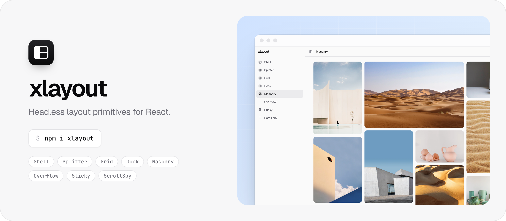
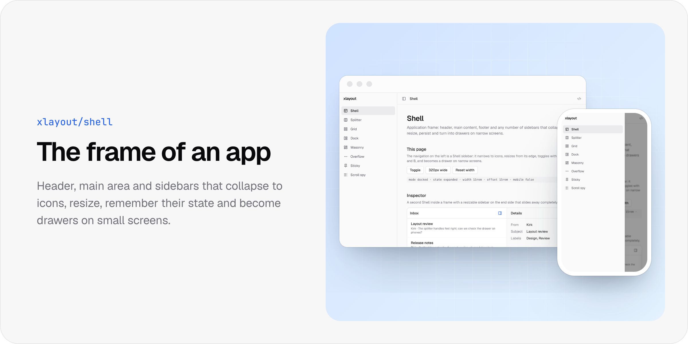
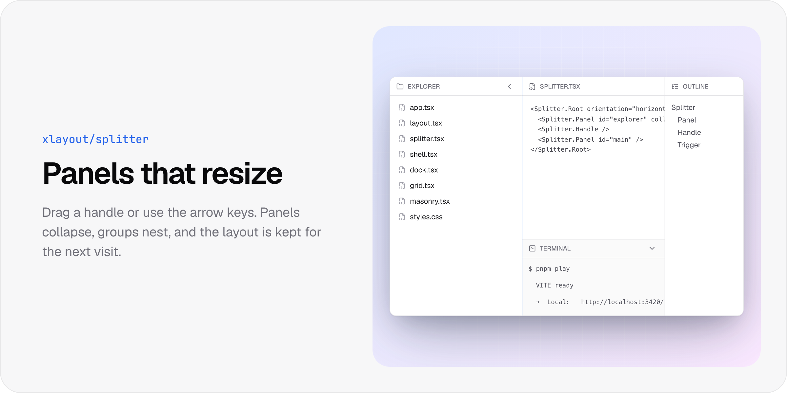
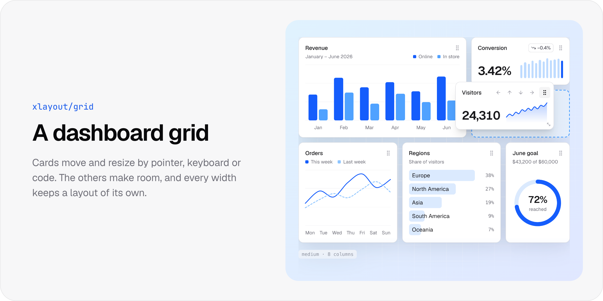
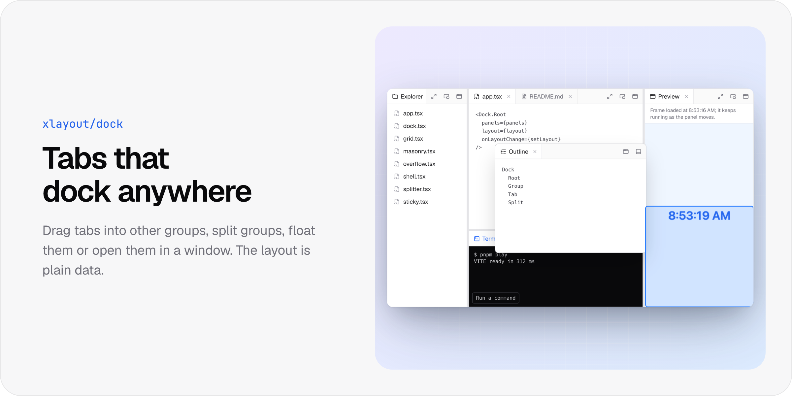
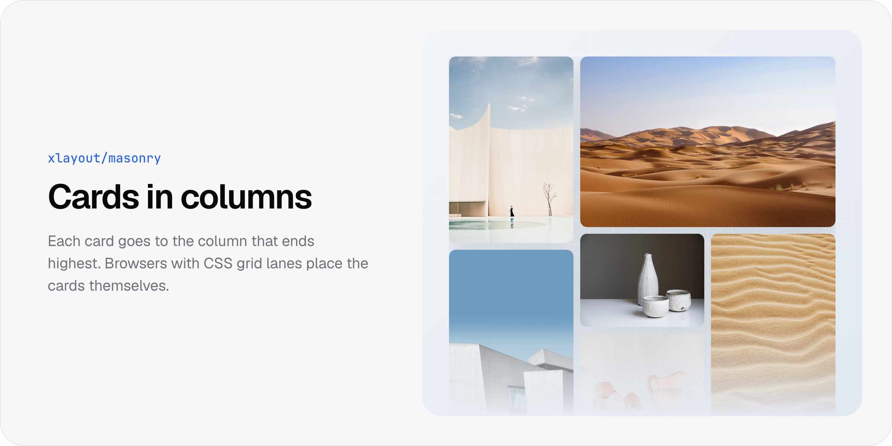
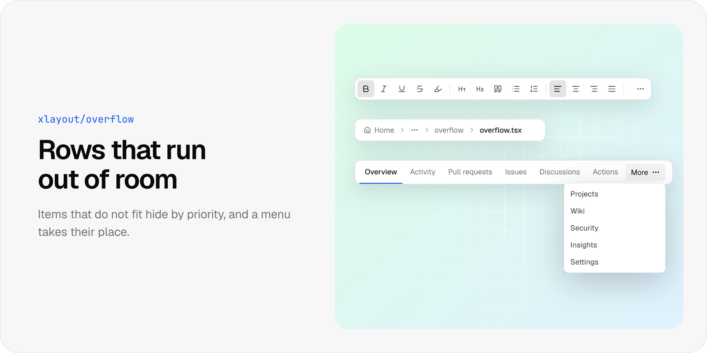
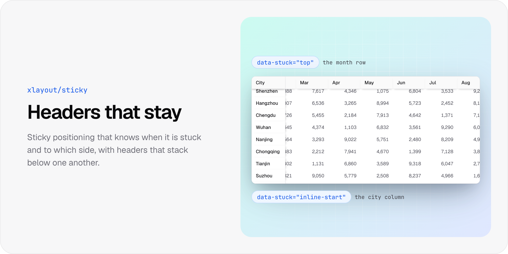
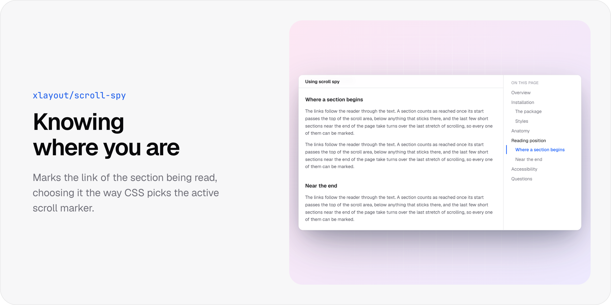

[](https://github.com/kirklin/xlayout)

# xlayout

**Headless, accessible layout primitives for React.**

xlayout is a low-level layout library for React: an app shell, resizable panels, a dashboard grid, docking tabs, masonry, overflow menus, sticky headers and scroll spy. The parts come without styles and report their state through `data-*` attributes and CSS variables, so they fit any design system.

---

## Components

















## Installation

```bash
npm i xlayout
```

xlayout needs React 19.2 or later.

## Usage

```tsx
import { Splitter } from "xlayout";

export function Editor() {
  return (
    <Splitter.Root className="h-screen">
      <Splitter.Panel id="files" defaultSize={25} minSize="12rem" collapsible>
        <FileTree />
      </Splitter.Panel>
      <Splitter.Handle className="w-1 bg-zinc-200 data-dragging:bg-blue-500" />
      <Splitter.Panel id="code">
        <CodeEditor />
      </Splitter.Panel>
    </Splitter.Root>
  );
}
```

Each component also has an entry of its own, such as `xlayout/splitter`. Server Components can render the parts and call helpers such as `Shell.parseShellState`.

## Contributing

Please follow our [contributing guidelines](./.github/CONTRIBUTING.md).

---

## License

Licensed under the MIT License, Copyright © 2026-present [Kirk Lin](https://github.com/kirklin).
